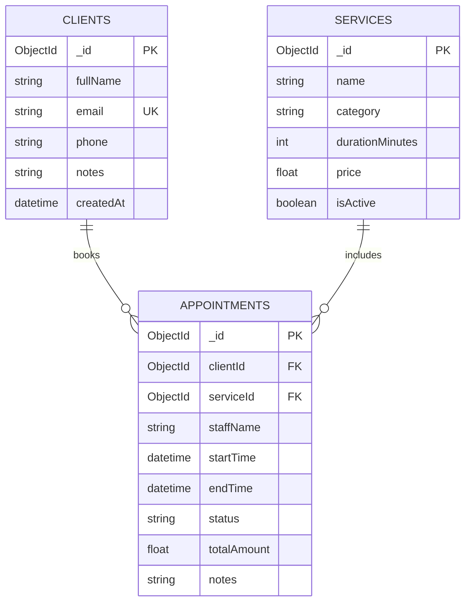

# Chronos Atelier — Full-Stack 3D Appointment & Booking Scheduler

[](https://nodejs.org)
[](https://expressjs.com)
[](https://www.mongodb.com)
[](https://react.dev)
[](https://docs.pmnd.rs/react-three-fiber)
[](https://www.docker.com)
[](https://aws.amazon.com)

A production-ready full-stack appointment and client scheduling application designed for modern clinics, salons, and studios. Pairs a scroll-choreographed **React Three Fiber** 3D booking landing experience with a zero-lag **Bento-grid Admin Workspace**, **Express + MongoDB Atlas** REST API (with overlap double-booking protection), **Docker Compose**, and **AWS** deployment guides.

---

## 🌟 Key Features

- **Choreographed 3D Canvas Hero**: Built with React Three Fiber (`@react-three/fiber` & `@react-three/drei`) featuring a smooth interactive 3D studio model that responds to cursor parallax and scroll depth.
- **Bento-Grid Administrative Workspace**: High-efficiency management dashboard with real-time statistics (today's bookings, revenue metrics, active clients), full-text search, and category filtering.
- **Conflict-Free Appointment Scheduling**: Automated overlap detection engine that queries staff schedules and rejects double-bookings with an HTTP `409 Conflict` before saving.
- **Client & Service Directory**: Comprehensive CRUD management for clinic/salon service offerings (durations, pricing, category) and client history records.
- **Containerized Architecture**: Multi-stage production `Dockerfile`s for both frontend (Vite &rarr; Alpine Nginx reverse proxy) and backend (Node.js 20 Alpine) orchestrated via `docker-compose.yml`.
- **Cloud-Ready Deployment**: Includes automated shell scripts and step-by-step guides for AWS EC2, AWS ECS Fargate, ALB target groups, and SSL termination.

---

## 🏗️ Architecture & Project Structure

```text
appointment-booking-scheduler/
├── backend/                     # Node.js 20 + Express + Mongoose API
│   ├── src/
│   │   ├── config/db.js         # MongoDB Atlas connection w/ retry & state reporting
│   │   ├── models/              # Service, Client, Appointment (with compound index)
│   │   ├── middleware/          # Request validation & centralized JSON error handling
│   │   ├── controllers/         # CRUD + 409 conflict overlap engine + dashboard metrics
│   │   ├── routes/              # /api/services, /clients, /appointments, /dashboard, /health
│   │   ├── seed/seed.js         # Sample clinic/salon services, clients & appointments
│   │   ├── app.js               # Express app (helmet, cors, rate-limit, morgan)
│   │   └── server.js            # Entrypoint + graceful SIGINT/SIGTERM shutdown
│   ├── Dockerfile
│   └── .dockerignore
├── frontend/                    # React 18 + Vite + Tailwind + R3F + Framer Motion
│   ├── src/
│   │   ├── api/client.js        # Typed fetch client using VITE_API_BASE_URL
│   │   ├── components/
│   │   │   ├── booking/         # <BookingHero3D />, Public Landing & Self-Booking Drawer
│   │   │   ├── admin/           # Dashboard Overview, Appointments, Clients, Services
│   │   │   └── ui/              # Modals, Confirm Dialog, Skeletons, Status Badges
│   │   ├── context/             # Global Toast & Dark/Light Surface Theme Contexts
│   │   └── hooks/               # Debounced search & reduced-motion utilities
│   ├── Dockerfile               # Multi-stage Vite build -> Nginx 1.27 Alpine
│   ├── nginx.conf               # SPA routing + /api/ reverse proxy
│   └── .dockerignore
├── docker-compose.yml           # Orchestrates frontend + backend over bridge network
├── .env.example
├── deploy-aws.sh                # Automated EC2 deployment script
└── README.md
```

---

## 🗄️ Database Models & Overlap Prevention



### Overlap Detection Query (MongoDB):
Before saving a new appointment for a staff member, the API queries:
```javascript
const conflict = await Appointment.findOne({
  staffName,
  status: { $ne: 'Cancelled' },
  $or: [
    { startTime: { $lt: reqEndTime }, endTime: { $gt: reqStartTime } }
  ]
});
if (conflict) {
  return res.status(409).json({ error: 'Staff member is already booked during this time slot.' });
}
```

---

## 🚀 API Reference

| Endpoint | Methods | Notes |
| :--- | :--- | :--- |
| `/api/health` | `GET` | Returns `200 OK` when MongoDB is connected, `503` otherwise |
| `/api/services` | `GET`, `POST` | Supports `?activeOnly=true` and `?category=` |
| `/api/services/:id` | `GET`, `PUT`, `DELETE` | Full CRUD for service offerings |
| `/api/clients` | `GET`, `POST` | Supports `?search=` matching fullName, email, or phone |
| `/api/clients/:id` | `GET`, `PUT`, `DELETE` | Full CRUD for client directory |
| `/api/appointments` | `GET`, `POST` | Filters: `?date=YYYY-MM-DD`, `?status=`, `?staffName=`, `?clientId=` |
| `/api/appointments/:id` | `GET`, `PUT`, `DELETE` | Auto-calculates `endTime`; returns `409 Conflict` on staff time overlap |
| `/api/appointments/:id/status` | `PATCH` | Fast status update (`Scheduled`, `Completed`, `Cancelled`, `No-Show`) |
| `/api/dashboard/stats` | `GET` | Today's count, status totals, total clients, estimated revenue |

---

## 💻 Quick Start (Local Development)

### 1. Environment Variables
```bash
cp .env.example .env
# Edit .env with your MongoDB connection string (or local MongoDB):
# MONGODB_URI=mongodb://localhost:27017/booking_scheduler
```

### 2. Backend Setup & Seed
```bash
cd backend
npm install
npm run seed    # Populates sample services, clients & appointments
npm run dev     # Starts Express API on http://localhost:5000
```

### 3. Frontend Setup
```bash
cd frontend
npm install
npm run dev     # Starts Vite dev server on http://localhost:5173 (proxies /api to :5000)
```

---

## 🐳 Docker Compose (Single-Command Run)

```bash
docker compose up --build -d
```

- Application UI: `http://localhost`
- Health Check: `http://localhost/api/health`

---

## ☁️ AWS Deployment Guide

### Option A: AWS EC2 (Ubuntu 24.04 LTS) + Docker Compose

1. **Launch EC2 Instance**:
   - AMI: **Ubuntu Server 24.04 LTS (HVM)** (`t3.small` or `t3.medium`).
   - Storage: `20 GB gp3` EBS volume.
   - Allocate an **Elastic IP** and associate it with your EC2 instance.
2. **Configure EC2 Security Group (Inbound Rules)**:
   - `SSH (TCP 22)` &rarr; Your trusted IP only
   - `HTTP (TCP 80)` &rarr; `0.0.0.0/0`
   - `HTTPS (TCP 443)` &rarr; `0.0.0.0/0`
3. **Whitelist EC2 Elastic IP in MongoDB Atlas**:
   - In **MongoDB Atlas &rarr; Network Access &rarr; Add IP Address**, enter `<YOUR_EC2_ELASTIC_IP>/32`.
4. **Deploy Application via `deploy-aws.sh`**:
   ```bash
   ssh -i your-key.pem ubuntu@<YOUR_EC2_ELASTIC_IP>
   git clone https://github.com/siddiquddin/appointment-booking-scheduler.git
   cd appointment-booking-scheduler
   cp .env.example .env
   nano .env   # Set MONGODB_URI
   chmod +x deploy-aws.sh
   ./deploy-aws.sh
   ```

---

## 🎤 Interview Talking Points & Technical Highlights

1. **Staff Schedule Conflict Algorithm**:
   *"To prevent staff double-booking, the API treats appointment windows as time intervals and performs a range-overlap check `(startA < endB && endA > startB)`. If any active booking intersects the requested slot, it throws a 409 Conflict."*
2. **Full-Stack Performance & 3D Optimization**:
   *"For the 3D canvas hero, I used `@react-three/fiber` with lazy loading and low polygon counts to ensure 60fps rendering without blocking the DOM or inflating initial bundle size."*
3. **Multi-Stage Docker Builds**:
   *"The frontend Dockerfile utilizes a multi-stage build: Stage 1 builds the production static assets with Vite, and Stage 2 serves them using a lean Alpine Nginx container. This minimizes image size from 500MB+ down to ~25MB."*

---

## 📄 License

This project is licensed under the MIT License.
